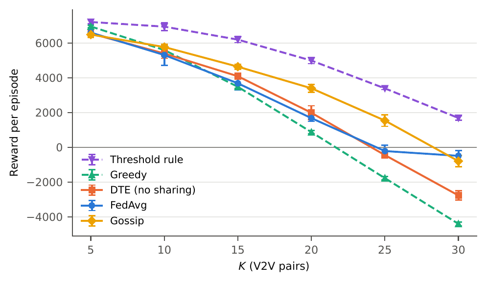

# Dynamic decentralized aggregation for federated MARL in V2V communications

Code and thesis for my undergraduate project in Systems and Computing Engineering at Universidad de los
Andes (2026), advised by Prof. Nicolás Cardozo at the FLAG lab.

Vehicles that talk directly to each other (V2V) can reuse the uplink channels of the cellular users in a
cell, at the cost of interfering with them. Every millisecond, each V2V pair has to pick a channel and a
transmit power. [Li et al. (2022)](https://doi.org/10.1109/TVT.2022.3173057) handle this with one D3QN
agent per pair: the base station averages the networks of all the agents every few slots (FedAvg) and
computes a single reward that all of them learn from.

I tried two changes to that scheme:

1. **Gossip instead of FedAvg.** Each vehicle averages its network only with the vehicles within 300 m.
   The base station takes no part in training, and the groups change with the positions of the vehicles.
2. **An individual reward.** Each agent is scored on what its own action can change (its queue, the
   reliability of its link, and the cellular user on the channel it picked) instead of on the sum over all
   agents.

Everything runs in simulation, with 5 to 30 V2V pairs, three seeds, and 2000 episodes per run. That comes
to 216 runs and about 800 hours of computation on Hypatia, the university's cluster.

## Results



*Final reward per episode against the number of pairs, with every learning method trained on the individual
reward. Dashed lines are the two rules that do not learn; error bars are the standard deviation across
seeds.*

All methods are judged by the same measure, the shared reward of Li et al., averaged over the last 200
episodes and the three seeds (higher is better):

| Pairs | Li et al., our implementation | Gossip + individual reward | Same, at most 2 neighbors | Threshold rule |
|---:|---:|---:|---:|---:|
| 5 | 6186 | 6492 | 6527 | 7215 |
| 10 | 4710 | 5775 | 5878 | 6948 |
| 15 | 2551 | 4645 | 4749 | 6201 |
| 20 | 1702 | 3402 | 3223 | 4997 |
| 25 | −1682 | 1545 | 1803 | 3396 |
| 30 | −2887 | −788 | 397 | 1694 |

- The two changes together beat the original scheme for every number of pairs and every seed (18 of 18
  paired comparisons).
- The reward is the more consistent of the two changes. Agents trained on their individual reward score
  higher, *on the shared reward*, than agents trained on the shared reward itself in 50 of 54 comparisons.
- With the individual reward, gossip beats FedAvg in all 12 comparisons with 10 to 25 pairs. With the
  shared reward, the two tie.
- Capping gossip at two neighbors per round keeps the reward: it still beats FedAvg in 16 of 18
  comparisons, and it never moves more models than FedAvg does.

Two things to keep in mind. First, "Li et al." here means my implementation of their scheme. It reproduces
part of their behavior but not their absolute numbers, so the comparison is against that implementation,
not against the published figures. Second, the threshold rule is a baseline I wrote by hand: transmit at
full power if your own link is strong, otherwise stay silent until your queue is almost full. It uses only
local information and still beats every learning method, mine included. The agents learn better with these
changes, but there is room left.

The thesis has the full story, including where the implementation departs from the paper and a diagnosis
of why our version of the original scheme loses performance at the end of training. Its source is in
`thesis-template/`, and `make paper` builds the PDF.

## What's in here

```
v2v/                  the simulator, the agents, and the tests
  v2v_env/            PettingZoo environment: channel, SINR, queues, reward
  agents/             D3QN, FedAvg, gossip, Greedy, and the threshold rule
  main.py             trains the learning methods
  train_greedy.py     runs the two fixed rules
  jobs/               Slurm scripts and the options of each sweep
  notebooks/          analysis notebooks (in Spanish)
  tests/              191 pytest tests
thesis-template/      the thesis in LaTeX, plus the script that builds its tables and figures
Makefile              submits the sweeps, pulls the results back, builds the thesis
try_pettingzoo/       my first experiments with PettingZoo
papers/               the papers the project builds on
reuniones/, resumenes/  notes from the advisor meetings (in Spanish)
```

## Running it

You need [uv](https://docs.astral.sh/uv/) and Python 3.11. PyTorch is pinned to the CUDA 11.8 build, but a
GPU is not needed: the network is small and most of the time goes into the simulator.

```bash
git clone https://github.com/JFH000/proyecto_de_grado.git
cd proyecto_de_grado/v2v
uv sync --frozen
uv run pytest
```

One run of the proposal, with 10 pairs and seed 0:

```bash
uv run python main.py --aggregation gossip --num-v2v-pairs 10 --episodes 2000 --seed 0 \
    --local-reward --reward-end-of-slot-queue --gamma 0.9 \
    --output runs/propia/k10/gossip_seed0.csv
```

Use `--aggregation fedavg` for FedAvg or `--aggregation none` for agents that never share (DTE). Without
`--local-reward --reward-end-of-slot-queue`, the agents learn from the shared reward. `--gossip-neighbors 2`
gives the capped variant. The fixed rules run with `train_greedy.py`, and `--policy umbral` selects the
threshold rule.

On two CPUs, an episode takes about 4 s with 10 pairs and 14 s with 30, so a full run takes 2 to 8 hours.
The sweeps ran on the cluster, one Slurm job per method and number of pairs, from the root of the repo:

```bash
make run-gossip SWEEP=propia RUN_ON=cpu
```

The sweeps kept their Spanish names: `propia` (individual reward), `paper` (shared reward), and
`propia-vecinos2` and `propia-vecinos3` (gossip with at most 2 or 3 neighbors). [`v2v/README.md`](v2v/README.md),
in Spanish, documents every flag, the columns of the output CSV, the cluster setup, and the diagnosis runs.

The results themselves are not in the repo. Once they are in `v2v/runs/` (`make pull-runs` copies them from
the cluster), this regenerates every table and figure of the thesis and compiles it:

```bash
v2v/.venv/bin/python thesis-template/scripts/generate_results.py
make paper
```

## Reference

X. Li, L. Lu, W. Ni, A. Jamalipour, D. Zhang, and H. Du, "Federated multi-agent deep reinforcement
learning for resource allocation of vehicle-to-vehicle communications," *IEEE Transactions on Vehicular
Technology*, vol. 71, no. 8, pp. 8810–8824, 2022. doi:
[10.1109/TVT.2022.3173057](https://doi.org/10.1109/TVT.2022.3173057)
